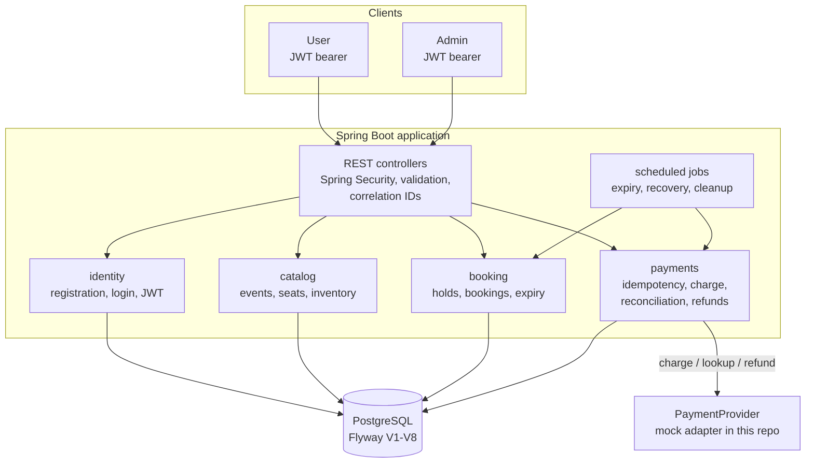
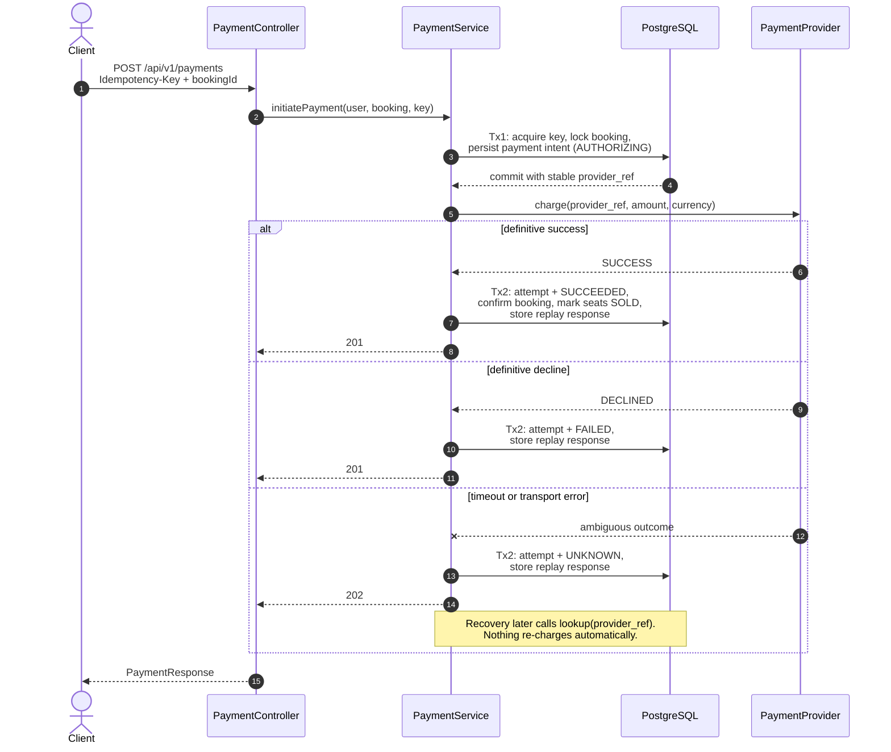

# Architecture

The current runtime is a single Spring Boot deployable backed by PostgreSQL.
Payment providers sit behind the `PaymentProvider` interface; the repository
ships only an in-process mock. There is no message broker, cache, or separate
worker process. Scheduled work runs inside the application process.

## System view

All modules share one process, datasource, and transaction manager. PostgreSQL
is the source of truth for application state: inventory, bookings, payments,
refunds, and audit history. The provider is authoritative for the external
charge or refund outcome; its definitive responses are persisted before the
application treats that money movement as final.

## Modules

| Package | Responsibility |
|---------|----------------|
| `identity` | Registration/login, BCrypt hashing, JWT issuance and validation, `USER`/`ADMIN` roles |
| `catalog` | Events, physical seats, event-specific inventory (`event_seats`), public reads |
| `booking` | Holds, bookings, booking expiry, scheduled hold release |
| `payments` | Payment initiation, idempotency, reconciliation, refunds, retention cleanup |
| `shared` | Security config, correlation IDs, error handling, OpenAPI, clock |

Dependencies point inward: controllers call services, and services own
transactions and repository access.

## Data model

- `users` — account identity and role.
- `venues`, `seats` — physical layout. A seat is unique per venue by code.
- `events` — one venue, title, start, price in minor units + currency.
- `event_seats` — sellable inventory: one row per event × seat, with status
  `AVAILABLE | HELD | SOLD`, holder id, and hold expiry. Unique `(event_id, seat_id)`.
- `holds` are not a separate table: a hold is a `HELD` event-seat row owned by a
  user until `hold_expires_at`.
- `bookings` — `PENDING_PAYMENT | CONFIRMED | EXPIRED | CANCELLED` (CANCELLED is
  reserved; no writer sets it). One row per checkout.
- `booking_items` — booking ↔ event seat. A partial unique index
  `(event_seat_id) WHERE released = false` guarantees at most one live booking per
  seat while preserving history after expiry.
- `payments` — one row per booking (`UNIQUE booking_id`), status
  `CREATED | AUTHORIZING | SUCCEEDED | FAILED | UNKNOWN | REFUNDED`, stable
  `provider_ref` assigned before any provider call.
- `payment_attempts` — every provider interaction, including timeouts.
- `idempotency_keys` — user-scoped request keys with request fingerprint, stored
  response, status, and expiry.
- `reconciliation_records` — append-only audit of payment transitions and manual
  review notes; verdicts `PROVIDER_SUCCESS`, `PROVIDER_SUCCESS_BOOKING_EXPIRED`,
  `PROVIDER_DECLINED`, `MANUAL_REVIEW`, `REFUND_COMPLETED`.
- `refunds` — at most one per payment (`UNIQUE payment_id`), status
  `REQUESTED | SUCCEEDED | FAILED | UNKNOWN`, stable `provider_refund_ref`.

Migrations `V1`–`V8` are immutable once applied. `V8` changes payment-attempt,
reconciliation-record, and refund foreign keys from `CASCADE` to `RESTRICT` so
financial history cannot be deleted through a payment deletion.

## Transaction boundaries

Payment and refund orchestration never call the provider inside a database
transaction:

1. **Tx1 (intent)** — lock the payment/booking row, validate state, persist the
   durable intent (payment + idempotency key, or refund with its stable provider
   reference), commit.
2. **Provider call** — outside all transactions and row locks, bounded by a
   timeout and executed on a dedicated thread pool.
3. **Tx2 (finalize)** — re-lock, re-verify state, then atomically record the
   attempt/outcome, transition the payment (and confirm the booking on success),
   and append the audit record.

Because state is re-verified under fresh locks in Tx2, concurrent live
completions, schedulers, and expiry cannot produce duplicate transitions or
duplicate audit records.

### Payment request flow

A captured payment whose booking has already expired is recorded as
`SUCCEEDED` with the `BOOKING_EXPIRED_AT_CONFIRM` annotation; seats stay
released and the payment appears in the Admin refund-required list. The same
outcome applies when the deadline has passed but the expiry sweeper has not yet
run: confirmation checks the deadline under lock and releases the booking
instead of selling the seat. See
[payment-lifecycle.md](payment-lifecycle.md) for the complete state machine.

## Concurrency and locking

- Hold acquisition, booking creation, booking expiry, and finalization use
  PostgreSQL `SELECT … FOR UPDATE` row locks. Exactly one concurrent hold per
  event seat succeeds. Confirmation under the lock re-checks the booking deadline
  and expires/releases the booking rather than confirming a stale hold.
- Reconciliation selectors use pessimistic write locks with `SKIP LOCKED`
  (`for no key update skip locked` in generated SQL), so workers skip rows held by
  live operations instead of blocking. Skipped rows are picked up in later cycles.
  Fresh `UNKNOWN` rows wait for `min-age-minutes`; stale `AUTHORIZING` rows are
  moved to `UNKNOWN` first, then resolved by the same lookup pass.
- Selectors are ordered deterministically (business timestamp + `id`) so paginated
  reads and batches are stable.
- Batch loops isolate failures per item: one malformed or conflicting row is
  logged, backed off, and skipped; the rest of the batch still resolves.

## Scheduling

- `HoldExpiryJob` releases expired holds and expires bookings.
- `ReconciliationJob` runs three isolated passes per cycle: crash-left
  `AUTHORIZING` recovery, ambiguous payments, then in-flight refunds. A failing
  pass never prevents the others from running.
- `PaymentCleanupJob` purges expired terminal idempotency keys.

Multi-instance deployments may duplicate scheduled work; row locks and state
re-verification keep outcomes consistent, but there is no cross-instance leader
election.

## Errors and observability

- JSON error envelope: `timestamp`, `status`, `code`, `message`,
  `correlationId`, `fieldErrors`.
- Malformed JSON, invalid path/query types, and missing parameters map to 400;
  unknown resources to 404; unsupported methods to 405; unexpected exceptions to
  500 with a server-side stack trace and correlation ID in the logs.
- `X-Correlation-ID` is propagated to logs and responses. Client-supplied IDs
  longer than 100 characters are replaced to bound log/response size.
- Actuator exposes `health` and `info` only; health details are disabled.

## Testing strategy

Integration tests run against real PostgreSQL, either Compose-backed or an
explicitly provisioned isolated instance. Concurrency tests use deterministic
gates and latches rather than sleep-only timing where possible.
Committed fixtures are released in teardown where the test owns them, but test
user accounts accumulate in the shared database.
